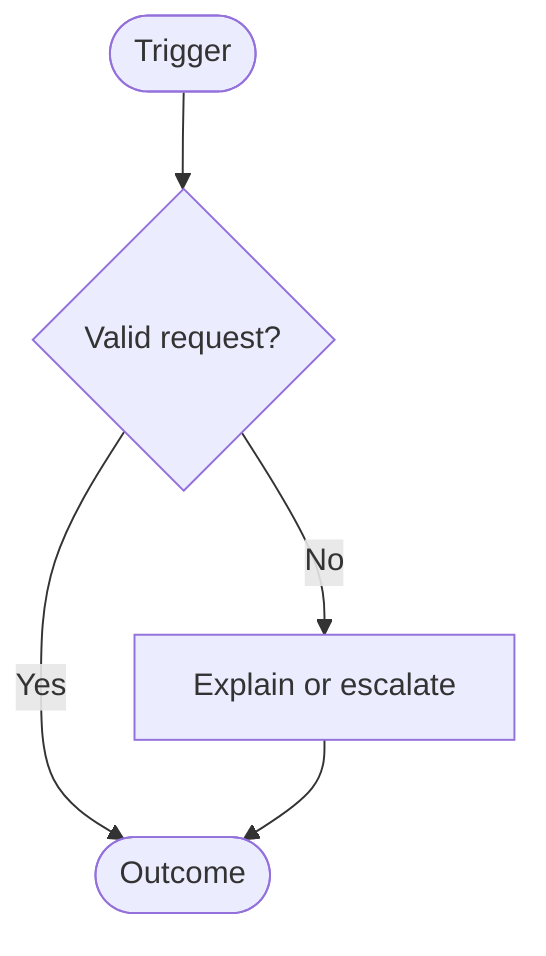
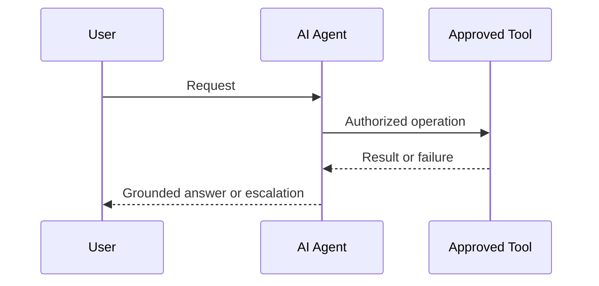
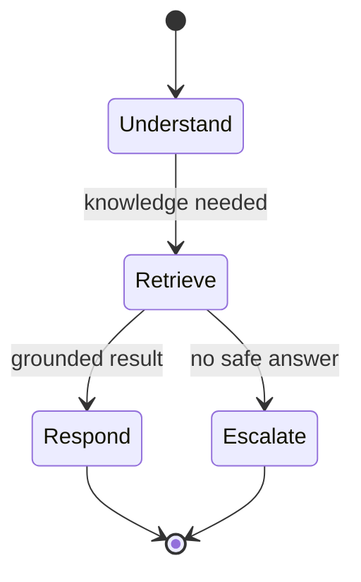
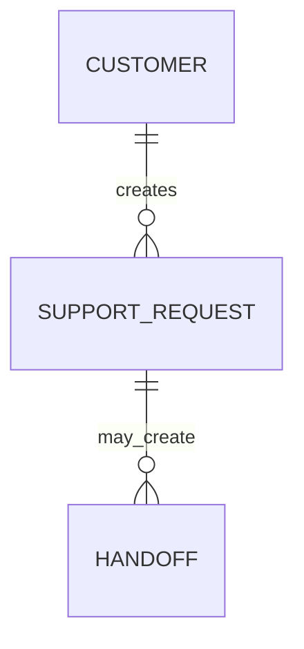

# Diagram Standards

Mermaid is the official diagram format for this vault. Keep diagrams in the Markdown note that owns the decision or flow; use image attachments only when Mermaid cannot express the artifact.

## Required diagram index

| Context | Required diagram | Owner note |
|---|---|---|
| Product/feature | User or business-process flow with success, alternative, and failure paths | Product Spec |
| AI Agent feature | Interaction sequence and agent state/failure flow | Tech Spec; Product Spec links to the relevant diagrams |
| AI Agent using knowledge/tools | Data flow showing trust, access, and retention boundaries | Tech Spec |
| System boundary | Context/container flow when external actors or systems matter | Architecture |
| Persistent business data | ERD or explicit justification for no persistent model | Architecture or Tech Spec |

## Authoring rules

- Use fenced `mermaid` blocks; do not paste rendered images as the only source.
- Give every diagram a heading and state the scope, source assumptions, and linked requirement IDs.
- Label alternate, denied, retry, escalation, and terminal paths where they materially affect the user or business.
- Keep node labels concise and do not include credentials, personal data, or production identifiers.
- Update the diagram and its traceability rows in the same change as a behavior change.

## Supported patterns

### Business process

### Interaction sequence

### Agent state and recovery

### Data model

