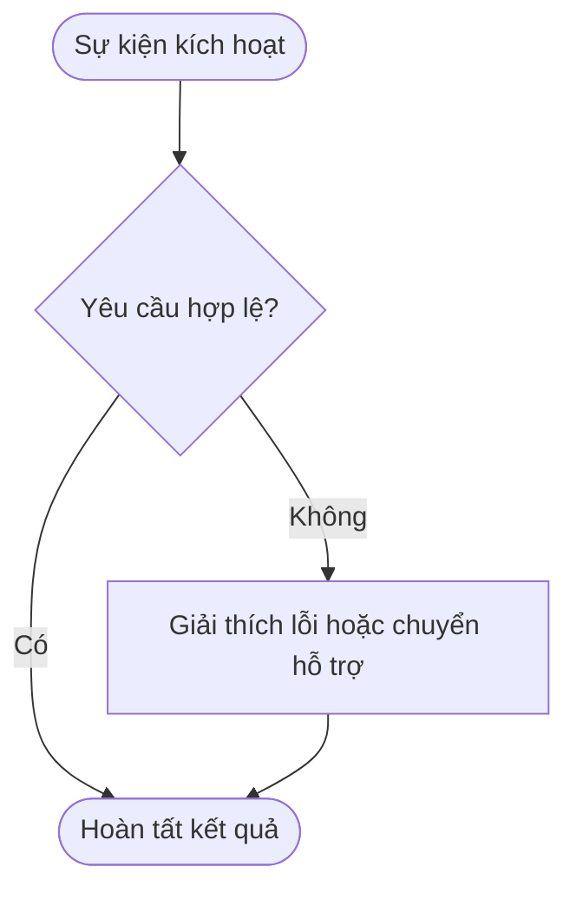
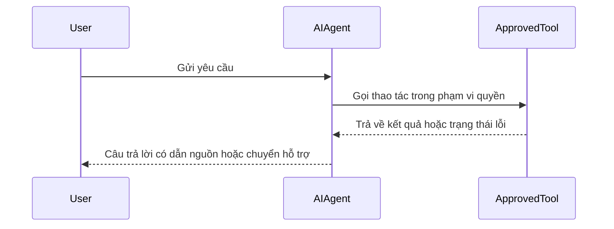
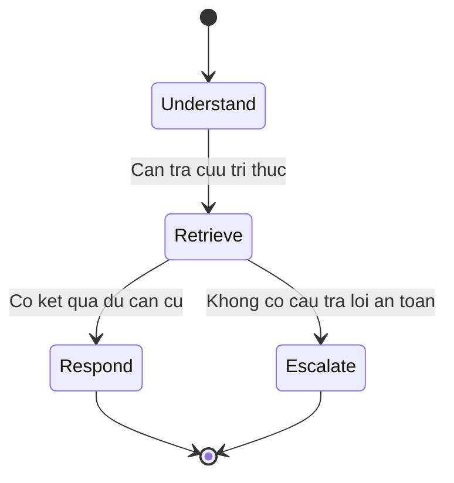
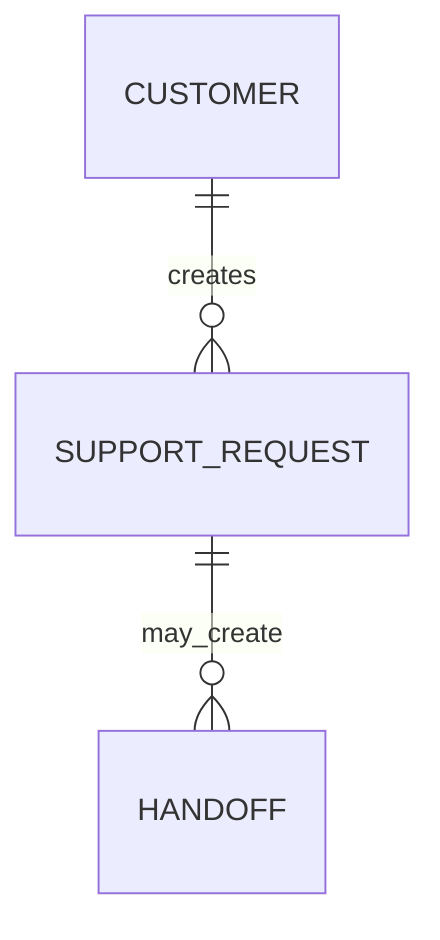

# Diagram Standards

**Mermaid** là định dạng sơ đồ chuẩn duy nhất được sử dụng xuyên suốt kho tài liệu này. Hãy đặt trực tiếp khối mã sơ đồ bên trong ghi chú Markdown sở hữu quyết định hoặc luồng nghiệp vụ đó; chỉ đính kèm ảnh tĩnh khi cú pháp Mermaid không thể biểu diễn được loại tài liệu đặc thù.

## Required diagram index

| Context | Required diagram | Owner note |
|---|---|---|
| Product/feature | Sơ đồ luồng người dùng hoặc quy trình nghiệp vụ có đủ nhánh thành công, thay thế và lỗi | Product Spec / Mini Spec |
| AI Agent feature | Sơ đồ chuỗi tương tác (`sequenceDiagram`) và sơ đồ trạng thái/phục hồi lỗi (`stateDiagram-v2`) | Tech Spec (Product Spec liên kết sang khi cần) |
| AI Agent using knowledge/tools | Sơ đồ luồng dữ liệu chỉ rõ ranh giới tin cậy, phạm vi quyền truy cập và lưu trữ trace | Tech Spec |
| System boundary | Sơ đồ bối cảnh/thành phần khi có tác nhân bên ngoài hoặc tích hợp liên hệ thống | Architecture |
| Persistent business data | Sơ đồ thực thể liên kết (`erDiagram`) hoặc giải trình rõ lý do không có mô hình lưu trữ bền vững | Architecture / Tech Spec |

## Authoring rules

- Luôn sử dụng khối mã rào chắn ```` ```mermaid ````; không dán mỗi ảnh chụp màn hình thay cho mã nguồn sơ đồ.
- Đặt tiêu đề cho mỗi sơ đồ và ghi rõ 3 thông tin ngay phía trên: phạm vi sơ đồ (`Scope`), giả định nguồn (`Assumptions`) và mã yêu cầu liên kết (`Linked requirements`).
- Đặt nhãn của các nút chứa dấu ngoặc tròn, dấu hai chấm, dấu hỏi, dấu gạch chéo hoặc tiếng Việt có khoảng trắng **bên trong dấu ngoặc kép** (ví dụ `Validate{"Yêu cầu hợp lệ?"}`) để tránh lỗi cú pháp khi trình biên dịch Mermaid render sang SVG.
- Thể hiện rõ các nhánh từ chối quyền, thử lại (retry), chuyển giao con người (escalation) và điểm kết thúc khi chúng ảnh hưởng trực tiếp tới người dùng hoặc an toàn dữ liệu.
- Giữ nhãn ngắn gọn; tuyệt đối không đưa khoá bí mật, dữ liệu cá nhân thật hay định danh hạ tầng nhạy cảm vào sơ đồ.
- Khi thay đổi hành vi hệ thống, bắt buộc cập nhật đồng thời sơ đồ và bảng truy vết trong cùng một lần chỉnh sửa.

## Supported patterns

### Business process



### Interaction sequence



### Agent state and recovery



### Data model


