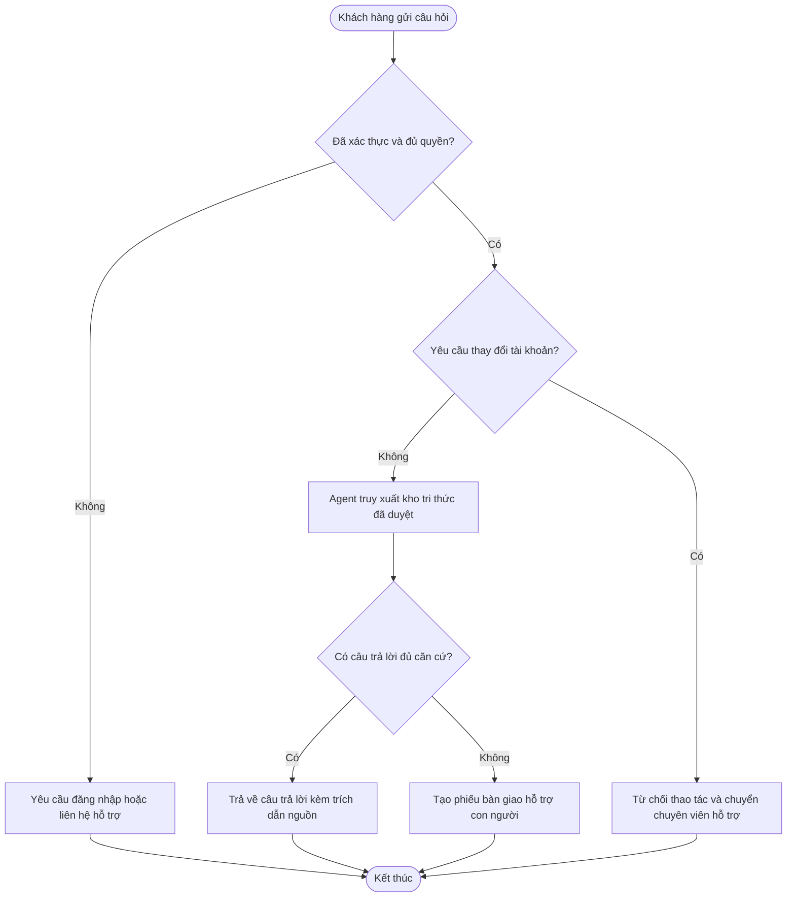

# Product Spec — Example AI Support Agent

- Related BA Foundation: [[01 - Overview/BA Foundation|BA Foundation]]
- Related specs: [2. Tech Spec](./2.%20Tech%20Spec.md), [3. QA Spec](./3.%20QA%20Spec.md), [4. Tasks](./4.%20Tasks.md)

## Problem and outcome

- Bài toán cần giải quyết: Khách hàng cần nhận câu trả lời hỗ trợ nhanh chóng nhưng bắt buộc bám sát nguồn tài liệu hướng dẫn đã được phê duyệt.
- Người dùng mục tiêu: Khách hàng đã đăng nhập và chuyên viên vận hành hỗ trợ.
- Kết quả mong đợi: Khách hàng nhận được câu trả lời kèm trích dẫn nguồn chính xác, hoặc được chuyển tiếp an toàn sang nhân viên hỗ trợ khi thiếu nguồn tin cậy.
- Ngoài phạm vi (Non-goals): Thay đổi thông tin tài khoản, hoàn tiền tự động hoặc trả lời dựa trên nguồn tri thức chưa được phê duyệt.

## Stakeholder, user stories, and use cases

| ID | Type | Statement / trigger and outcome | Priority | Related AC |
|---|---|---|---|---|
| ST-01 | User story | Là một khách hàng, tôi muốn nhận câu trả lời kèm nguồn trích dẫn rõ ràng để tự đánh giá độ tin cậy của hướng dẫn. | Must | AC-01 |
| UC-01 | Use case | Khách hàng gửi câu hỏi hỗ trợ; kích hoạt khi gửi tin nhắn; thành công khi trả về câu trả lời có dẫn nguồn; nhánh thay thế chuyển giao sang chuyên viên hỗ trợ. | Must | AC-01, AC-02 |

## Business rules

| ID | Rule / decision | Exception | Owner | Related AC |
|---|---|---|---|---|
| BR-01 | Agent chỉ được phép trả lời từ nguồn tri thức đã được duyệt và nằm trong phạm vi quyền truy cập của khách hàng. | Không tìm thấy nguồn hợp lệ -> chuyển giao sang bộ phận hỗ trợ con người. | support-operations | AC-01, AC-02 |
| BR-02 | Agent tuyệt đối không được thực hiện các thao tác làm thay đổi dữ liệu tài khoản hoặc giao dịch. | Chuyên viên hỗ trợ tiếp nhận và xử lý thủ công yêu cầu thay đổi. | support-operations | AC-03 |

## User flow

- Phạm vi sơ đồ (Scope): Một khách hàng đã xác thực gửi yêu cầu hỗ trợ tra cứu chỉ đọc.
- Giả định nguồn (Assumptions): Dịch vụ định danh, kiểm tra quyền, kho tri thức đã duyệt và hàng đợi bàn giao hỗ trợ đều sẵn sàng; các yêu cầu thay đổi tài khoản được nhận diện trước bước truy xuất.
- Yêu cầu liên kết (Linked requirements): BG-01, ST-01, UC-01, BR-01, BR-02, AC-01, AC-02, AC-03.

## Acceptance criteria

| ID | Scenario | Expected result |
|---|---|---|
| AC-01 | Khách hàng đã xác thực đặt câu hỏi nằm trong phạm vi kho tri thức được cấp quyền. | Agent trả về câu trả lời bám sát nội dung gốc kèm mã trích dẫn nguồn hợp lệ. |
| AC-02 | Không có nguồn tri thức được phép nào đủ căn cứ trả lời câu hỏi. | Agent thông báo rõ không thể xác minh câu trả lời và đề xuất chuyển sang chuyên viên hỗ trợ. |
| AC-03 | Khách hàng yêu cầu thực hiện thao tác thay đổi dữ liệu tài khoản. | Agent từ chối thực hiện thao tác ghi và điều hướng yêu cầu sang chuyên viên hỗ trợ. |

## Dependencies and non-functional expectations

| Area | Requirement / decision | Owner |
|---|---|---|
| Dependencies | Dịch vụ kiểm tra quyền truy cập, chỉ mục tri thức đã duyệt và hàng đợi phiếu hỗ trợ. | engineering |
| Privacy / data classification | Không đưa dữ liệu cá nhân nhạy cảm vào prompt ngoài ngữ cảnh phiên yêu cầu đã được cấp quyền. | privacy |
| Accessibility / usability | Nguồn trích dẫn và trạng thái chuyển giao hỗ trợ phải hiển thị rõ ràng bằng văn bản, không phụ thuộc riêng vào màu sắc. | product |
| Performance / availability | Xác định mục tiêu độ trễ phản hồi và cơ chế chuyển giao dự phòng trước khi phát hành. | engineering |

## Traceability

| Business goal / stakeholder need | Story / use case / rule | Product AC | Diagram / mockup | Owner |
|---|---|---|---|---|
| BG-01: hỗ trợ tự phục vụ có dẫn nguồn | ST-01 / UC-01 / BR-01 | AC-01, AC-02 | User flow | product |
| BG-01: ranh giới an toàn hỗ trợ | UC-01 / BR-02 | AC-03 | User flow | support-operations |

## Open decisions

- [x] Chốt đơn vị sở hữu kho tri thức chuẩn và ngưỡng thời gian phản hồi mục tiêu (quyết định mẫu: bộ phận Support Operations quản lý chỉ mục trung tâm trợ giúp; độ trễ p95 <= 4 giây trước khi kích hoạt nhánh bàn giao con người).
