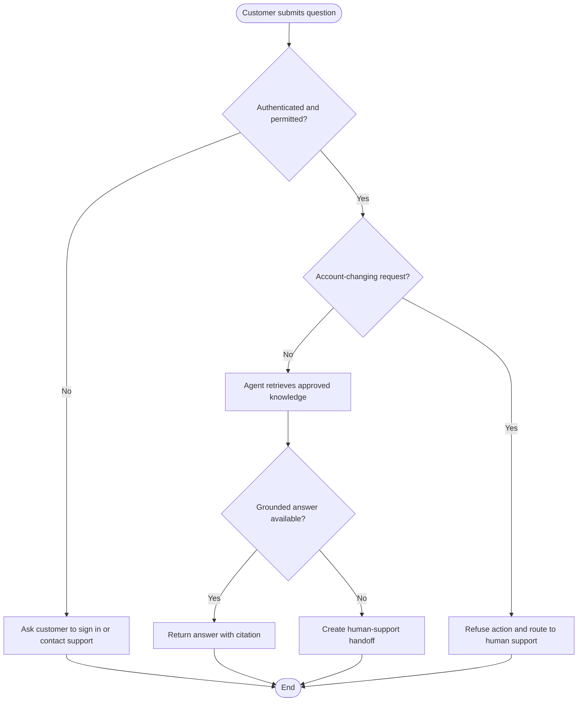

# Product Spec — Example AI Support Agent

- Related BA Foundation: [[BA Foundation]]

## Problem and outcome

- Problem: Support customers need answers grounded in approved help content.
- Target users: Authenticated customers and support specialists.
- Desired outcome: A customer receives a cited answer or a safe handoff.
- Non-goals: Changing account data, issuing refunds, or answering from unapproved knowledge.

## Stakeholder, story, and use case

| ID | Type | Statement | Priority | Related AC |
|---|---|---|---|---|
| ST-01 | User story | As a customer, I want an answer with a source so I can judge its reliability. | Must | AC-01 |
| UC-01 | Use case | Customer asks a support question; trigger: submitted message; success: cited response; alternate: human handoff. | Must | AC-01, AC-02 |

## Business rules

| ID | Rule | Exception | Owner | Related AC |
|---|---|---|---|---|
| BR-01 | The agent may answer only from customer-authorized, approved knowledge. | No eligible source → hand off to support. | Support operations | AC-01, AC-02 |
| BR-02 | The agent must not perform account-changing actions. | Support specialist handles the request. | Support operations | AC-03 |

## User flow

- Scope: An authenticated customer requests read-only support help.
- Assumptions: Identity, authorization, approved knowledge, and handoff services are available; account-changing requests are detected before retrieval.
- Linked requirements: BG-01, ST-01, UC-01, BR-01, BR-02, AC-01, AC-02, AC-03.

## Traceability

| Business goal / stakeholder need | Story / use case / rule | Product AC | Diagram / mockup | Owner |
|---|---|---|---|---|
| BG-01: grounded self-service support | ST-01 / UC-01 / BR-01 | AC-01, AC-02 | User flow | Product |
| BG-01: safe support boundary | UC-01 / BR-02 | AC-03 | User flow | Support operations |

## Acceptance criteria

| ID | Scenario | Expected result |
|---|---|---|
| AC-01 | An authenticated customer asks a question covered by authorized knowledge. | The agent returns a grounded answer and citation. |
| AC-02 | No authorized source supports the answer. | The agent says it cannot verify the answer and offers human handoff. |
| AC-03 | A customer requests an account-changing action. | The agent refuses the action and routes to human support. |

## Dependencies and non-functional expectations

| Area | Requirement / decision | Owner |
|---|---|---|
| Privacy / data classification | Do not include personal data in prompts beyond the authorized request context. | Privacy |
| Accessibility / usability | Citations and handoff must be understandable without color alone. | Product |
| Performance / availability | State a response target and fallback behavior before approval. | Engineering |

## Open decisions

- [ ] Define the approved knowledge owner and response-time target.
