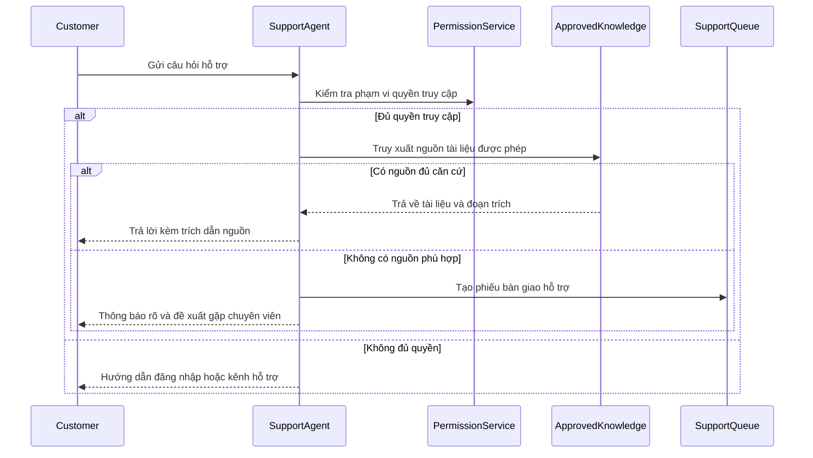
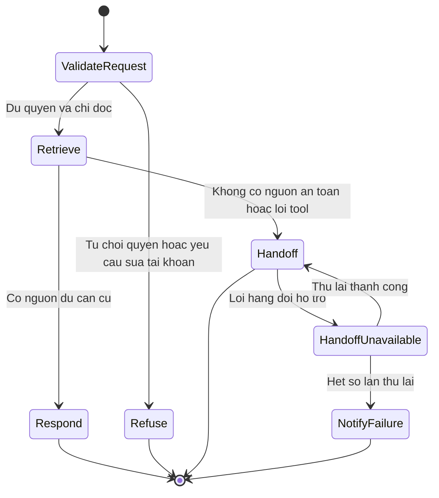
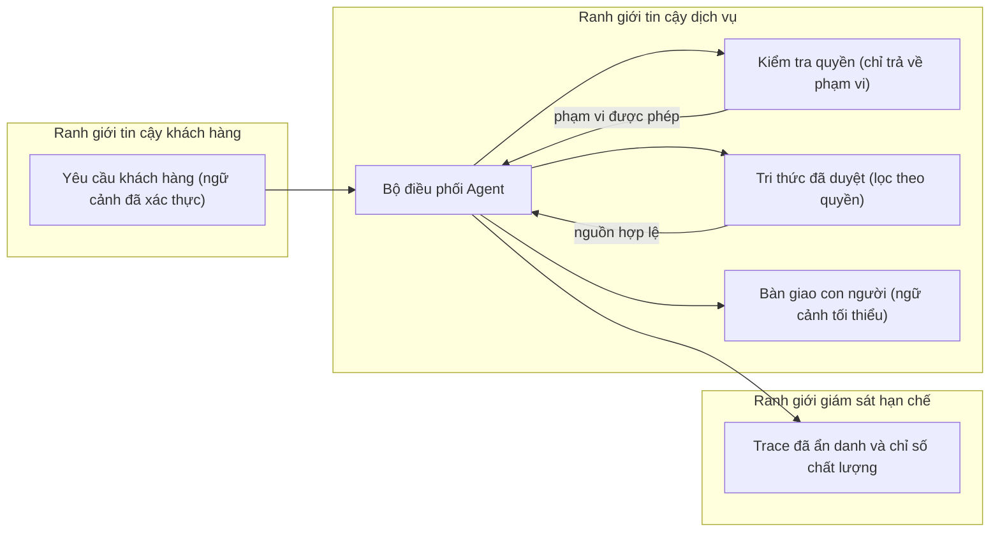

# Tech Spec — Example AI Support Agent

## Scope and dependencies

- Related specs: [1. Product Spec](./1.%20Product%20Spec.md), [3. QA Spec](./3.%20QA%20Spec.md), [4. Tasks](./4.%20Tasks.md)
- Affected modules, routes, jobs, schemas, or integrations: Dịch vụ kiểm tra danh tính/phân quyền (`Permission Service`), chỉ mục tri thức đã phê duyệt (`Approved Knowledge`) và hàng đợi bàn giao hỗ trợ (`Support Queue`).

## Design

- Xác thực danh tính và phạm vi quyền truy cập của khách hàng trước khi truy xuất bất kỳ tài liệu nào.
- Khảo sát phạm vi ảnh hưởng trên hệ thống hiện hữu (brownfield blast radius): chỉ gắn thêm luồng đọc vào chỉ mục tri thức hiện có và tạo phiếu trên hàng đợi hỗ trợ; phương án cấp trực tiếp tool ghi dữ liệu tài khoản đã bị loại bỏ để tuân thủ `BR-02` và giữ thiết kế tối giản.
- Chỉ truy xuất các tài liệu thuộc phạm vi quyền của khách hàng hiện tại và đính kèm định danh nguồn vào phản hồi.
- Từ chối mọi yêu cầu thay đổi tài khoản ngay ở tầng chính sách trước bước chọn tool; tuyệt đối không đăng ký tool có quyền ghi dữ liệu khách hàng.
- Khi không tìm thấy nguồn hợp lệ, quá thời gian chờ (timeout) hoặc gặp nội dung không an toàn, tạo phiếu bàn giao sang con người thay vì tự suy diễn câu trả lời.

For every diagram, record:

- Phạm vi sơ đồ (Scope): Xem chi tiết ngay trên từng sơ đồ tương tác, trạng thái và ranh giới dữ liệu bên dưới.
- Giả định nguồn (Assumptions): Các dịch vụ nội bộ giao tiếp qua hợp đồng xác thực chuẩn và log truy vết được ẩn danh trước khi lưu.
- Yêu cầu liên kết (Linked requirements): BR-01, BR-02, AC-01, AC-02, AC-03, QA-01, QA-02, QA-03.

### Agent interaction

- Phạm vi sơ đồ (Scope): Luồng xử lý câu trả lời theo phạm vi quyền hoặc tạo phiếu bàn giao cho một yêu cầu hỗ trợ đơn lẻ.
- Giả định nguồn (Assumptions): `Permission Service`, `Approved Knowledge` và `Support Queue` cung cấp hợp đồng dịch vụ nội bộ có xác thực.
- Yêu cầu liên kết (Linked requirements): BR-01, BR-02, AC-01, AC-02, AC-03.

### State and recovery

- Phạm vi sơ đồ (Scope): Các trạng thái kết thúc hợp lệ cho một yêu cầu hỗ trợ, bao gồm cả kịch bản lỗi hàng đợi bàn giao.
- Giả định nguồn (Assumptions): Cơ chế thử lại (retry) khi tạo phiếu bàn giao có giới hạn hữu hạn; lỗi hàng đợi không bao giờ được phép khiến agent tự bịa câu trả lời.
- Yêu cầu liên kết (Linked requirements): BR-01, BR-02, AC-02, AC-03, QA-02, QA-03.

### Data boundary

- Phạm vi sơ đồ (Scope): Luồng di chuyển thông tin qua các ranh giới tin cậy của khách hàng, tầng dịch vụ, kho tri thức, hệ thống giám sát và hàng đợi bàn giao.
- Giả định nguồn (Assumptions): Dữ liệu trace được lọc bỏ thông tin nhạy cảm trước khi lưu theo chính sách lưu trữ của dự án; agent chỉ nhận phạm vi quyền đã xác thực chứ không nhận khoá bí mật (credentials).
- Yêu cầu liên kết (Linked requirements): BR-01, AC-01, AC-02, QA-01, QA-02.

## Contracts, operations, and change safety

| Area | Design / evidence | Owner |
|---|---|---|
| API / event contract and versioning | Hợp đồng phản hồi hỗ trợ có phiên bản, kèm mảng mã trích dẫn nguồn và trạng thái chuyển giao con người. | engineering |
| Schema or data migration | Không thay đổi bảng nghiệp vụ lõi; đánh phiên bản chỉ mục tri thức và bộ dữ liệu đánh giá `eval-v1`. | engineering |
| Observability (logs, metrics, alerts) | Theo dõi tỷ lệ trả lời có nguồn, tỷ lệ bàn giao con người, độ trễ p95, lỗi tool và chi phí ước tính trên trace đã ẩn danh. | engineering |
| Deployment and rollback plan | Triển khai qua cờ tính năng (feature flag); cho phép quay lui tức thời về luồng tạo phiếu hỗ trợ truyền thống. | engineering |
| Dependencies / third-party failure mode | Giới hạn thời gian chờ truy xuất/model và số lần thử lại hàng đợi; trả thông báo lỗi trung thực khi dịch vụ phụ thuộc gián đoạn. | engineering |
| AI addendum: model / policy / prompt version | Ghim phiên bản model, system policy, mẫu prompt và phiên bản chỉ mục tri thức trong bản ghi trace ẩn danh. | engineering |
| AI addendum: Tool permissions, timeout, retry, fallback | Chỉ cấp quyền cho 2 tool: tra cứu tri thức chỉ đọc và tạo phiếu bàn giao hỗ trợ; quy định rõ timeout, số lần retry và nhánh dự phòng từng tool. | engineering |
| AI addendum: knowledge provenance, citation, retention | Chỉ truy xuất nguồn đã duyệt theo quyền khách hàng, bắt buộc đính kèm mã trích dẫn và giới hạn thời gian lưu trace theo chính sách bảo mật. | security |
| AI addendum: human escalation and evaluation threshold | Chuyển chuyên viên hỗ trợ khi thiếu nguồn/gặp yêu cầu ghi dữ liệu; yêu cầu đạt >= 95% câu trả lời dẫn nguồn đúng trên tập `eval-v1`. | qa |

## Acceptance-criteria mapping

| Product AC | Implementation approach | Automated validation |
|---|---|---|
| AC-01 | Truy xuất giới hạn theo quyền kết hợp bộ kết xuất trích dẫn nguồn bắt buộc. | Kiểm thử tích hợp luồng truy xuất và định dạng phản hồi có dẫn nguồn. |
| AC-02 | Nhánh không tìm thấy nguồn hợp lệ tự động khởi tạo phiếu bàn giao con người. | Kiểm thử hồi quy kịch bản không có nguồn tài liệu phù hợp. |
| AC-03 | Tầng chính sách chặn các yêu cầu thay đổi tài khoản trước bước lựa chọn tool. | Kiểm thử chính sách từ chối hành động bị cấm. |

## Risks and open decisions

- [x] Xác định ngưỡng chất lượng phát hành, bộ dữ liệu đánh giá chuẩn và đơn vị tiếp nhận leo thang trước khi vận hành thực tế (quyết định mẫu: tỷ lệ dẫn nguồn đúng >= 95% trên bộ `eval-v1`; nhóm Support Tier-2 sở hữu hàng đợi leo thang).
