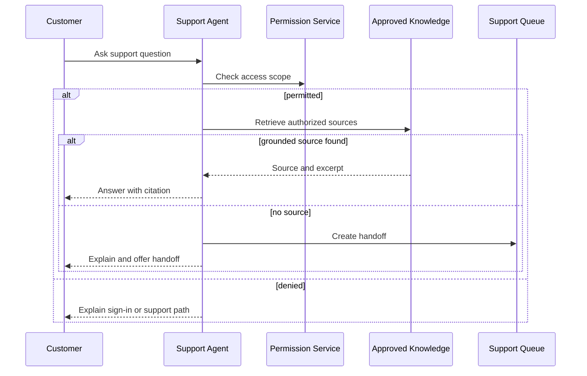
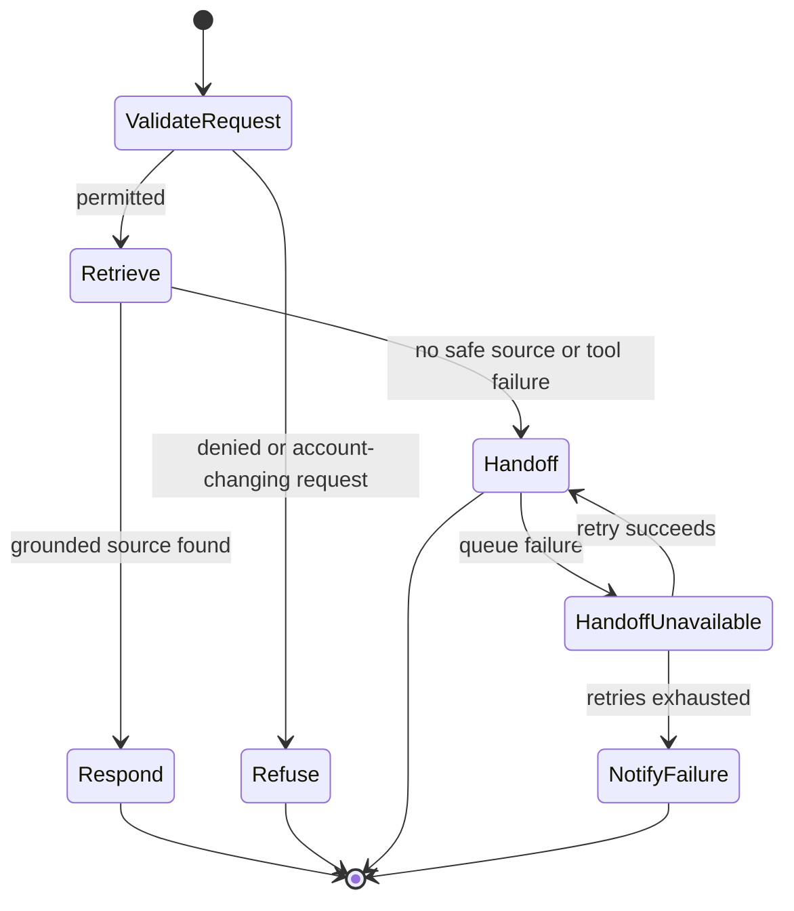
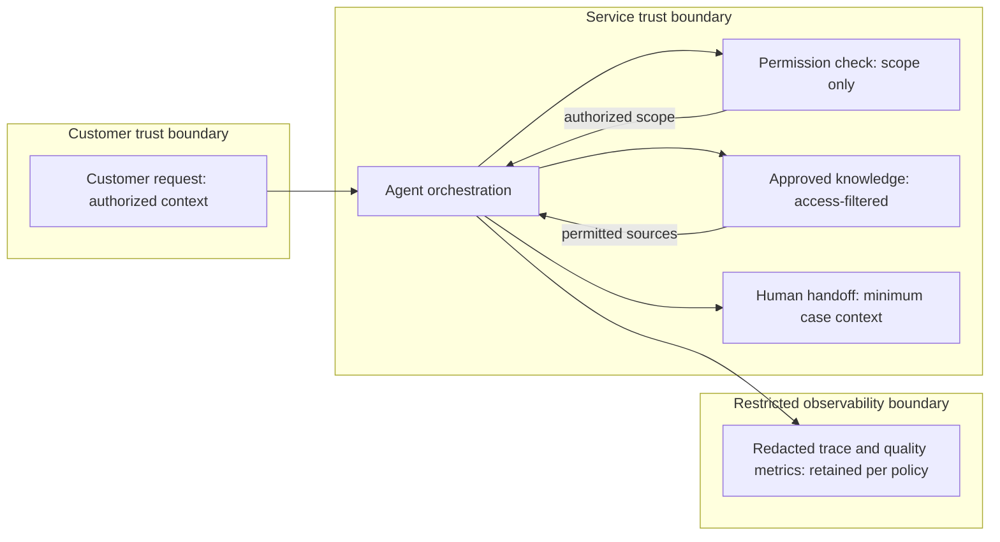

# Tech Spec — Example AI Support Agent

## Scope and dependencies

- Related Product Spec: [[1. Product Spec]]
- Dependencies: identity/permission check, approved knowledge index, support handoff queue.

## Agent interaction

- Scope: Permission-scoped answer and handoff processing for one customer request.
- Assumptions: Permission Service, approved knowledge, and the Support Queue expose authenticated service contracts.
- Linked requirements: BR-01, BR-02, AC-01, AC-02, AC-03.

## State and recovery

- Scope: Terminal state for an individual support request, including handoff failure.
- Assumptions: Handoff retry has a bounded policy; an unavailable queue cannot cause the agent to fabricate an answer.
- Linked requirements: BR-01, BR-02, AC-02, AC-03, QA-02, QA-03.

## Data boundary

- Scope: Information movement across the customer, agent, authorization, knowledge, observability, and handoff boundaries.
- Assumptions: The trace is redacted before storage and retained only under the project-approved retention policy; the agent receives authorization scope, not credentials.
- Linked requirements: BR-01, AC-01, AC-02, QA-01, QA-02.

## Design

- Validate identity and authorization before retrieval.
- Retrieve only sources permitted for the customer; attach source identifiers to the response.
- Refuse account-changing actions; do not invoke write-capable tools.
- On no source, timeout, or unsafe content, create a handoff without fabricating an answer.

## Contracts, operations, and change safety

| Area | Design / evidence | Owner |
|---|---|---|
| Tool registry | Read-only knowledge retrieval and support-handoff creation; permissions, timeout, and fallback documented per tool. | Engineering |
| AI policy / versioning | Record model, system-policy, prompt, and knowledge-index versions in a redacted trace. | Engineering |
| Observability | Track grounded-answer rate, handoff rate, latency, tool errors, and estimated cost. | Engineering |
| Safety | Treat retrieved and user content as untrusted; filter prompt-injection attempts and never expose secrets. | Security |

## Acceptance-criteria mapping

| Product AC | Implementation approach | Automated validation |
|---|---|---|
| AC-01 | Permission-scoped retrieval plus citation rendering. | Retrieval and response integration test. |
| AC-02 | No-source branch creates human handoff. | No-source regression test. |
| AC-03 | Policy denies write actions before tool selection. | Policy test for prohibited action. |

## Risks and open decisions

- [ ] Define quality threshold, evaluation dataset, and human escalation owner before production use.
